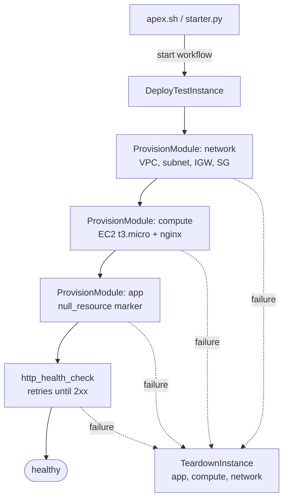

# Apex Temporal Demo

Ephemeral AWS test environments provisioned by Terraform and orchestrated by [Temporal](https://temporal.io).

One command builds a VPC, an EC2 instance running nginx, and an app marker, then health-checks the instance over HTTP. If anything fails along the way, the workflow tears down whatever it already built. If the worker crashes mid-deploy, the workflow resumes where it left off when the worker comes back.

The point of the demo: Terraform knows how to change infrastructure, but not how to run a multi-step deploy reliably. Temporal supplies the missing pieces (ordering, retries, rollback, crash recovery, timers, and a full audit trail) as plain Python code.

## What it demonstrates

| Capability | Where you see it |
|---|---|
| **Durable orchestration** | Network, compute, and app modules run in order, each as a child workflow with its own event history. |
| **Saga rollback** | A failure at any step, or cancelling the workflow, runs a compensating teardown, including for a module that failed partway through. |
| **Crash recovery** | Kill the worker with `kill -9` mid-deploy; on restart it continues without rebuilding finished modules. |
| **Retries with backoff** | The HTTP health check retries connection errors and 5xx responses until the instance finishes booting. Permanent Terraform errors fail fast instead. |
| **Idempotent teardown** | Teardown reads Terraform state first and skips empty modules, so running it twice is safe. |
| **Durable timers** | `--ttl` keeps an environment alive for N seconds and then destroys it, even across worker restarts. |
| **Human approval** | `--require-approval` pauses each module after `terraform plan` until someone approves or rejects it with a workflow Update. The `plan_summary` query shows what would change. |
| **Signals and queries** | During a TTL wait, the `status` query reports the URL and expiry, and the `extend_ttl` and `teardown_now` signals change the timer. |
| **Observability** | Every step is visible in the Temporal UI; worker metrics are exposed in Prometheus format. |

## How it works



Each `ProvisionModule` child runs `terraform plan` and, if the plan has changes, `terraform apply`. With `--require-approval`, it waits for an approve or reject decision between the two. It then returns the module's outputs, so compute gets the subnet and security group IDs that network created.

The activities shell out to the `terraform` CLI in a per-environment workspace at `terraform/_workspaces/<env>/<module>/`. State lives in S3 at `s3://$TF_STATE_BUCKET/apex-temporal-demo/<env>/<module>.tfstate`, protected by S3 native state locking.

**Workflows** (all on task queue `nonprod-provisioning`):

| Workflow | Started by | Workflow ID |
|---|---|---|
| `DeployTestInstance` | `starter.py` | `deploy-<env>` |
| `ProvisionModule` | child of deploy and swap | `provision-<module>-<env>` |
| `SwapInstance` | `swapper.py` | `swap-<env>-<version>` |
| `TeardownInstance` | `teardown.py`, rollback, TTL | `teardown-<env>`, `rollback-<env>-<ts>`, `teardown-ttl-<env>` |

## Deploy targets

The same workflows run against any of three targets. Each target has its own worker and task queue, so work started for one can never run on the other.

| Target | What runs | Needs | Task queue | Workflow IDs |
|---|---|---|---|---|
| `aws` (default) | Real Terraform against real AWS | Terraform, AWS credentials, state bucket | `nonprod-provisioning` | as in the table above |
| `local` | Real Terraform against [Floci](https://floci.io), a local AWS emulator | Terraform, Docker | `nonprod-provisioning-local` | `@local` suffix (`deploy-<env>@local`) |
| `sim` | Simulated activities: no Terraform, no AWS | Only Temporal | `nonprod-provisioning-sim` | same, with an `@sim` suffix (`deploy-<env>@sim`) |

The `sim` activities register under the same names and return the same types as the real ones, so everything Temporal does is real: retries, saga rollback, approvals, TTL timers, and crash recovery from `kill -9`. Plans list the same resources as the Terraform modules, simulated state lives in `.sim_state/<env>/` (it survives a worker crash), and instance IPs come from the documentation range `198.51.100.0/24`. Each step (network, compute, app, health check) takes about 10 seconds, so a full deploy takes under a minute; `SIM_SPEED=0.3` makes it snappier.

```bash
python worker.py --target sim          # terminal 1
python starter.py demo-01 --target sim # terminal 2
```

Every CLI takes `--target`, defaulting to `$APEX_TARGET` (or `aws`); `./apex.sh` asks for one. You can run all three workers side by side.

Tune the simulation with environment variables on the **sim worker**:

| Variable | Default | Effect |
|---|---|---|
| `SIM_SPEED` | `1` | Multiplies every simulated delay; `0` is instant, `0.3` is snappy |
| `SIM_FAIL` | | Failures to inject, comma-separated. `compute:apply` fails every attempt (non-retryable, triggers rollback); `network:apply:flaky` fails the first two attempts, then succeeds; `health:check:flaky` is an instance slow to boot. Modules: `network`, `compute`, `app`, or `health:check`; steps: `plan`, `apply`, `destroy`. |

For example, `SIM_FAIL=compute:apply python worker.py --target sim` shows a rollback of a partly built compute module without touching AWS.

### Local target (Floci)

The `local` target runs the **real Terraform modules** against Floci, an open-source AWS emulator running in Docker. Floci runs each EC2 instance as a container, so user data really installs nginx and the health check really fetches the page, all on your laptop with no AWS account and no VPC quota.

```bash
docker compose --profile local up -d floci   # Floci 2.2.0 on :4566 (state persists in a volume)
python check.py --target local               # Terraform, Docker, Floci, state bucket
python worker.py --target local              # terminal 1
python starter.py demo-01 --target local     # terminal 2; ends with url http://localhost:30000/
```

How it fits together:

- **Same modules, plus overrides.** For this target the worker copies the files in [`terraform/local/`](terraform/local/README.md) into each workspace (`terraform/_workspaces_local/`). Terraform merges `*_override.tf` files natively, so `terraform/modules/` is exactly what runs on AWS. The overrides point the provider and S3 backend at Floci and work around four Floci differences, each commented in [`compute_override.tf`](terraform/local/compute_override.tf).
- **State** lives in the `apex-local-state` bucket inside Floci, which the worker creates on startup. It never touches your AWS state bucket.
- **Reaching the instance.** Floci forwards the instance's port 80 to a host port from 30000 up, but reports `127.0.0.1` as its IP. The local compute module names the instance `<instance-id>.floci.localhost`, and the local worker's health check asks Docker which port Floci forwarded (`activities/floci.py`). The deploy then reports the URL that answered, so the link in the console works.
- **Timing.** A deploy takes about 2 minutes, mostly `dnf install nginx` inside the instance (slower on Apple Silicon, where the x86 image runs emulated). Swap takes about 1 minute; teardown about 25 seconds.
- **Version.** Pinned to Floci 2.2.0. Floci 1.5.x has broken API filters that make the AWS provider hang (`aws_route_table_association`) or fail (`aws_instance`).

Floci needs the Docker socket (it starts the instance containers), so it runs as root in its container. Stop it with `docker compose --profile local stop floci`; `docker compose --profile local down -v` also deletes its state.

## Demo console (web UI)

`python ui.py` serves a control panel at http://localhost:8000 over the same workflows the CLIs drive:

- **Target switch** (AWS / Local (Floci) / Simulated), with a live indicator of whether that target's worker is polling
- **Deploy form**: approval, fail app deploy, TTL
- **Live pipeline**: network → compute → app → health. Each step shows plan, approval, apply and retry state (attempt number and last error, read from pending activities), with a link to its workflow in the Temporal UI
- **Plan review**: Approve / Reject buttons that send the `decide` Update, with the reason recorded in history
- **TTL controls**: a countdown, plus **+5 minutes** and **Tear down now** (the `extend_ttl` and `teardown_now` signals)
- **Swap and teardown** actions, and every workflow for the deploy (children, rollback, teardowns) in one list
- **Simulated failures** (sim target only): checkboxes the sim worker reads on every attempt, so you can make the next step flaky or fail without restarting it

```bash
python worker.py --target sim   # terminal 1
python ui.py                    # terminal 2, then open http://localhost:8000
```

The UI holds no state; everything comes from Temporal, so it survives a refresh or a restart. It links to the Temporal UI at `$TEMPORAL_UI_URL` (default http://localhost:8233). The **Approve** button is the answer to "how does our own UI talk to a waiting workflow?": it's one `execute_update` call on the workflow ID (see `decide` in `ui.py`).

## Prerequisites

For the `sim` target you only need Python and a Temporal server; for `local`, add Terraform and Docker. Both skip the AWS and bucket steps below.

- **Python 3.12+**
- **Terraform 1.10+** (for S3 native state locking)
- **Docker** (for the local Temporal server), or the [Temporal CLI](https://docs.temporal.io/cli)
- **AWS credentials** for an account where you can create VPCs and EC2 instances. Any standard method works (`aws configure`, SSO, environment variables).
- **An S3 bucket** for Terraform state (created in step 2 below)

> **Cost and limits:** each environment creates one VPC and one `t3.micro` in **us-east-1**. AWS allows 5 VPCs per region by default. Tear environments down when you're done.

## Quick start

### 1. Install

```bash
git clone git@github.com:aaronaycock/apex-temporal-demo.git
cd apex-temporal-demo
python3 -m venv .venv
source .venv/bin/activate
pip install -r requirements.txt
cp .env.example .env
```

### 2. Create a state bucket

Bucket names are global, so pick a unique one:

```bash
BUCKET=apex-tf-state-$(whoami)-$RANDOM
aws s3api create-bucket --bucket "$BUCKET" --region us-east-1
aws s3api put-bucket-versioning --bucket "$BUCKET" --versioning-configuration Status=Enabled
echo "TF_STATE_BUCKET=$BUCKET"
```

Put the printed value in `.env`.

### 3. Start Temporal

```bash
docker compose up -d
```

This starts Temporal with Postgres and the Temporal UI at **http://localhost:8233**.

If you'd rather not use Docker, `temporal server start-dev` works too and serves the UI on the same port.

### 4. Check your setup

```bash
python check.py
```

```
[ok  ] terraform on PATH: Terraform v1.14.9
[ok  ] module network
[ok  ] module compute
[ok  ] module app
[ok  ] AWS credentials: arn:aws:iam::123456789012:user/you
[ok  ] state bucket: s3://apex-tf-state-you-12345
[ok  ] Temporal server: localhost:7233 (default)
```

### 5. Run the worker

In its own terminal:

```bash
source .venv/bin/activate
python worker.py
```

### 6. Provision an environment

In a second terminal:

```bash
source .venv/bin/activate
./apex.sh
```

Choose **Provision → Standard → ephemeral-test-01**. When the workflow finishes, it prints the instance URL; open it to see the nginx page. Follow the workflow live in the UI at http://localhost:8233.

## Demo walkthrough

Each scenario can be run from the `./apex.sh` menu or with the command shown. A good order for a live demo:

### 1. Happy path

```bash
python starter.py ephemeral-test-01
```

In the UI, open `deploy-ephemeral-test-01` and point out:

- The three child workflows, which run in order.
- The health check failing and retrying while the instance boots.
- The result, which contains the URL.

### 2. Rolling update

```bash
python swapper.py ephemeral-test-01 v2
```

Swap reads the network outputs from state, then re-applies compute with `app_version=v2`. The changed user data forces Terraform to replace the instance. The new instance gets a new public IP, and its page reads `v2`.

### 3. Saga rollback

```bash
python starter.py fail-app-01 --fail-app-deploy
```

Network and compute build, then the app module's apply fails on purpose (its `local-exec` provisioner exits non-zero, a permanent `AppDeployError`). A `rollback-fail-app-01-<ts>` child destroys app, compute, and network in reverse order, and the deploy ends as **Failed** instead of retrying forever. Afterwards, the AWS console shows no `apex-fail-app-01-*` resources.

### 4. Crash recovery

```bash
python starter.py chaos-test-01
```

Any env name starting with `chaos-` adds a 30-second heartbeating step between network and compute. During that window:

1. Kill the worker: `pkill -9 -f worker.py`, or use `kill -9 <pid>`.
2. In the UI, the activity stops heartbeating and times out after about 10 seconds.
3. Restart the worker: `python worker.py`.
4. The workflow picks up at the step that was interrupted and goes straight on to compute. Network is **not** rebuilt, because its completed result is already in the workflow history.

### 5. Self-destructing environment

```bash
python starter.py ephemeral-test-02 --ttl 300
```

After the deploy passes its health check, the starter prints the URL and expiry time, and the workflow waits on a durable timer for 5 minutes before tearing down. You can Ctrl-C the starter (the workflow keeps running on the server) or even restart the worker; the timer still fires.

While it waits, query and signal the running workflow with the [Temporal CLI](https://docs.temporal.io/cli), or from the workflow's page in the UI:

```bash
temporal workflow query  --workflow-id deploy-ephemeral-test-02 --name status
temporal workflow signal --workflow-id deploy-ephemeral-test-02 --name extend_ttl --input 600
temporal workflow signal --workflow-id deploy-ephemeral-test-02 --name teardown_now
```

Cancelling the workflow instead (`temporal workflow cancel --workflow-id deploy-ephemeral-test-02`, or **Request Cancellation** in the UI) also tears the environment down, and the run ends as **Canceled**.

### 6. Human approval

```bash
python starter.py ephemeral-test-03 --require-approval
```

Each module stops after `terraform plan` and waits for a decision before it applies anything. The starter prints the plan summary (add/change/destroy counts and resource addresses) and the commands to decide it:

```
Approval needed:
network/ephemeral-test-03: awaiting-approval
  plan: 6 to add, 0 to change, 0 to destroy
    + aws_internet_gateway.this
    ...
  approve: python approve.py ephemeral-test-03 network --approve --reason "..."
  reject:  python approve.py ephemeral-test-03 network --reject --reason "..."
```

In a second terminal (or **Approve/Reject a plan** in `./apex.sh`):

```bash
python approve.py ephemeral-test-03 network                       # show the plan again
python approve.py ephemeral-test-03 network --approve --reason "CIDR checked"
```

Approve network, then reject compute:

```bash
python approve.py ephemeral-test-03 compute --reject --reason "wrong instance size"
```

The compute module fails with a non-retryable `ApprovalRejected` error, and the deploy rolls back the network it already built, exactly as in the saga rollback scenario. Things to point out:

- The decision is a workflow **Update** named `decide`, so the reason is in the child's history, and `approve.py` gets an answer back. Its validator refuses a decision when the module isn't waiting, for example a second approval of the same plan.
- `approve.py ENV MODULE` finds the child workflow (`provision-<module>-<env>`) for you. Without a flag it only shows the plan. The same summary is available from the CLI or the UI's **Queries** tab: `temporal workflow query --workflow-id provision-network-ephemeral-test-03 --name plan_summary`.
- The wait is a durable timer: restart the worker and the module keeps waiting. With no decision within 24 hours (`--approval-timeout SECONDS` to change it) the module fails with `ApprovalTimeout` and the deploy rolls back. Try `--approval-timeout 60` and walk away.
- What gets applied is what was approved. The saved plan file is applied as is. If it's gone at apply time (the worker restarted on a fresh disk, or apply ran on another host) or apply is retried, the module plans again. If the new plan's summary differs from the approved one, nothing is applied, and the module waits for a second approval of the new plan (`round 2` in the summary).

### 7. Cleanup and idempotency

```bash
python teardown.py ephemeral-test-01
python teardown.py ephemeral-test-01   # second run: every module "skipped (state empty)"
```

## Command reference

| Command | Purpose |
|---|---|
| `./apex.sh` | Interactive menu for provision, swap, and teardown. Asks for a target unless `APEX_TARGET` is set. Prints the command before running it. |
| `python starter.py [ENV] [--ttl SECONDS] [--fail-app-deploy] [--require-approval [--approval-timeout SECONDS]]` | Provision an environment (default `ephemeral-test-01`). With `--require-approval`, each module plan with changes waits for `approve.py` (default timeout 24h). |
| `python approve.py ENV MODULE [--approve \| --reject] [--reason TEXT]` | Show a module's plan waiting for approval, and approve or reject it. |
| `python swapper.py ENV VERSION` | Replace the instance with a new app version. |
| `python teardown.py ENV` | Destroy an environment. Safe to re-run. |
| `temporal workflow signal --workflow-id deploy-ENV --name extend_ttl --input SECONDS` | Push back a TTL teardown. `--name teardown_now` (no input) tears down immediately. |
| `python check.py` | Preflight check of tools, AWS access, state bucket, and Temporal. With `--target local`: Terraform, Docker, Floci; with `--target sim`: only Temporal. |
| `python ui.py [--port 8000]` | Run the demo console. |
| `python worker.py [--target aws\|local\|sim]` | Run the worker for one target. Metrics at http://localhost:9090/metrics (`aws`), :9093 (`local`) or :9092 (`sim`). |

Every `python` command above also takes `--target aws|local|sim` (default `$APEX_TARGET`, else `aws`). For `local` and `sim` workflows, add `@local` or `@sim` to workflow IDs in `temporal` commands, e.g. `--workflow-id deploy-ENV@sim`.
| `scripts/reset.sh ENV` | Break-glass cleanup that runs Terraform directly, without Temporal. |

## Tests

```bash
pip install -r requirements-dev.txt
pytest
```

The suite takes about a minute and needs no AWS account, Terraform, or running Temporal server:

- **Workflow tests** run the real workflows on a throwaway Temporal dev server, with the Terraform and HTTP activities swapped for in-memory mocks. They cover the TTL query and signals, cancelling during the TTL wait and mid-apply, failure rollback, swap, and approval (approve, reject, timeout, and re-approval when the plan changes before apply). Each test then replays its workflow histories against the current code to catch non-determinism. The dev server comes from the `temporal` CLI if it's on your PATH; otherwise the SDK downloads it on the first run.
- **Sim tests** run the real workflows against the simulated activities on the `sim` task queue: deploy and idempotent teardown, an injected failure rolling back, a flaky step retrying, rejecting a plan, and swap.
- **UI tests** drive the console's API against the real workflows and sim activities: deploy, approve and reject through the API, the validator refusing a second decision, and fault toggles reaching the worker.
- **Local target tests** check which Floci overrides land in each workspace, the separate state bucket, and the health check resolving an instance name to Floci's forwarded port (against a fake `docker`). The end-to-end path needs Floci running, so it's a manual check: deploy, swap, fail app deploy, and teardown with `--target local`.
- **Activity tests** run the Terraform activities against a fake `terraform` script (`tests/bin/terraform`, bash, so macOS or Linux) and the health check against a local HTTP server. They cover error classification, re-planning on retry, plan summaries and comparing a re-plan with the approved plan, interrupting `terraform` on cancel, and health status codes.

Run `pytest` before changing a workflow. If a replay check fails, the change would break workflows already running; see [versioning](https://docs.temporal.io/develop/python/versioning).

## Project layout

```
.
├── worker.py                  Temporal worker: registers all workflows and activities
├── starter.py                 Start a deploy
├── swapper.py                 Start an app version swap
├── teardown.py                Start a teardown
├── approve.py                 Show, approve, or reject a module plan
├── check.py                   Preflight checks
├── apex.sh                    Interactive demo menu
├── ui.py                      Demo console: FastAPI over the Temporal client
├── ui/index.html              Demo console page (no build step)
├── workflows/
│   ├── deploy_test_instance.py   Parent: network, compute, app, health, rollback, TTL
│   ├── provision_module.py       Child: plan, optional approval, then apply if needed
│   ├── swap_instance.py          Re-apply compute with a new app version
│   └── teardown_instance.py      Destroy in reverse order, skipping empty state
├── activities/
│   ├── terraform.py           terraform init/plan/apply/destroy/output via subprocess
│   ├── health.py              HTTP health check
│   ├── floci.py               Local target: finds Floci's port forward, creates the state bucket
│   └── sim.py                 Simulated versions of both, for the sim target
├── shared/
│   ├── config.py              Settings loaded from .env
│   ├── targets.py             Deploy targets: task queue and workflow ID per target
│   └── idempotency.py         Deterministic per-activity idempotency key
├── terraform/modules/
│   ├── network/               VPC, public subnet, IGW, route table, HTTP security group
│   ├── compute/               t3.micro (Amazon Linux 2023) with nginx via user data
│   └── app/                   null_resource marker; simulate_failure fails its apply on purpose
├── terraform/local/           Override files that point the modules at Floci (local target)
├── scripts/
│   ├── render_prometheus.py   Render prometheus.yml from the template and .env
│   └── reset.sh               Break-glass Terraform cleanup
├── tests/
│   ├── conftest.py            Throwaway Temporal dev server shared by the workflow tests
│   ├── test_workflows.py      Real workflows with mocked activities, plus replay checks
│   ├── test_sim.py            Real workflows against the simulated activities
│   ├── test_ui.py             The console's API against the sim target
│   ├── test_floci.py          Local target: overrides, state bucket, port resolution
│   ├── test_terraform_activities.py   Terraform activities against a fake terraform
│   ├── test_health_activity.py        Health check against a local HTTP server
│   └── bin/terraform          Fake terraform CLI used by the activity tests
├── pytest.ini                 Test settings
├── requirements-dev.txt       Runtime requirements plus pytest
└── docker-compose.yml         Temporal, Postgres, Temporal UI, optional Prometheus and Floci
```

## Configuration

Settings come from `.env` (see `.env.example`):

| Variable | Default | Purpose |
|---|---|---|
| `APEX_TARGET` | `aws` | Default target for the worker and CLIs: `aws`, `local`, or `sim` |
| `TF_STATE_BUCKET` | *(required for `aws`)* | S3 bucket for Terraform state |
| `TF_STATE_REGION` | `us-east-1` | Region of the state bucket |
| `TEMPORAL_ADDRESS` | `localhost:7233` | Temporal frontend |
| `TEMPORAL_NAMESPACE` | `default` | Temporal namespace |
| `TEMPORAL_TASK_QUEUE_NONPROD` | `nonprod-provisioning` | Task queue for `aws`; other targets append `-<target>` |
| `SIM_SPEED`, `SIM_FAIL` | | Simulation knobs, read by the `sim` worker (see [Deploy targets](#deploy-targets)) |
| `FLOCI_ENDPOINT` | `http://localhost:4566` | Floci's endpoint, for the `local` target |
| `LOCAL_STATE_BUCKET` | `apex-local-state` | Terraform state bucket inside Floci (created by the local worker) |
| `TEMPORAL_UI_URL` | `http://localhost:8233` | Where the demo console links to workflows |
| `GRAFANA_PROM_*` | | Grafana Cloud remote write, only for the metrics profile |

AWS resources are always created in **us-east-1**; the region is set in the Terraform modules.

## Optional: metrics in Grafana Cloud

The worker always serves Prometheus metrics on `:9090`. To ship them to Grafana Cloud, fill in the `GRAFANA_PROM_*` values in `.env`, then run:

```bash
python scripts/render_prometheus.py      # writes prometheus.yml (gitignored, contains your key)
docker compose --profile metrics up -d
```

Prometheus scrapes the worker through `host.docker.internal:9090` and remote-writes to Grafana. Its own UI is at http://localhost:9091.

## Design notes

- **S3 native state locking, no DynamoDB.** Workflow IDs stop a second deploy of the same environment, but deploy, swap, and teardown use different IDs and can overlap on the same state. Each module's backend sets `use_lockfile = true`, so overlapping plans, applies, and destroys wait up to 2 minutes for the S3 lock, then the activity retries. Each plan also writes its own plan file, so one workflow can't apply another's plan.
- **Retries match the failure.** Permanent Terraform failures (bad config, bad credentials, a missing bucket, an AWS quota) are non-retryable and fail on the first attempt. Lock contention, throttling, and a stale plan retry with backoff, and a retried apply re-plans from current state first.
- **Cancelling tears down too.** Cancelling a deploy interrupts any running `terraform` with SIGINT, so it saves state and releases the lock, then runs the same teardown as a failure. The run ends as **Canceled**, not Failed.
- **Idempotency keys.** Each activity derives a key from its workflow run ID and activity ID (`shared/idempotency.py`). The key stays the same across retries of that activity and is applied to AWS resources as the `ApexIdempotencyKey` tag, so you can trace any resource back to the activity that last touched it. Side effect: the tag changes on every new run, so a plan against existing infrastructure always shows tag updates and is never a no-op.
- **Approval summaries stay small.** The plan summary comes from `terraform show -json` but keeps only counts, at most 50 resource addresses, and a fingerprint of the full changes (ignoring the per-run idempotency key). That's what goes into workflow history and what a re-plan is compared against; the full plan stays on the worker's disk. Plans are only summarized with `--require-approval`.
- **Rollback is best-effort and never hides the cause.** If the compensating teardown itself fails, the deploy still reports the original error and logs a hint to run `teardown.py`.
- **State is kept after teardown.** Destroy empties the state files but doesn't delete them, which leaves an audit trail in S3.

## Limitations

- **Plan files are local to the worker.** If apply runs on a different host than its plan, or is a retry, it re-plans from current state and applies that plan instead of the one the plan step showed. With `--require-approval`, that re-plan is applied only if its summary matches the approved one; otherwise it needs approval again.
- **Approval is only for deploys.** `swapper.py` and teardown (including rollback) don't wait for approval.
- **Don't kill the worker during `terraform apply`.** The retry re-plans, so a stale plan no longer fails the deploy. But `kill -9` on the worker also breaks the output pipe of the `terraform` process it started, which can kill it mid-apply, leaving a stale state lock and resources Terraform didn't record. The chaos demo's 30-second window exists so you can kill the worker at a safe point.
- **Swap leaves the app marker unchanged.** Only compute moves to the new version; the `app` module still reports `v1`.

## Troubleshooting

| Symptom | Fix |
|---|---|
| `TF_STATE_BUCKET is not set` at worker start | Copy `.env.example` to `.env` and set the bucket. |
| `Workflow 'deploy-X' is already running` | Wait for it, terminate it in the UI, or choose another env name. |
| Workflow stuck with nothing happening | The worker isn't running, or it's polling a different task queue. Check `python worker.py` output. |
| `terraform init failed` | Credentials expired or no access to the bucket. Run `python check.py`. |
| Health check exhausts its retries | The instance didn't serve HTTP within 5 minutes (connection errors and 5xx retry; a 4xx fails at once). Check the EC2 console and system log for user-data errors. |
| `Error acquiring the state lock` on every retry | A crashed run, usually a `kill -9` during apply, left a lock in S3. Confirm nothing is running, then run `terraform force-unlock <LOCK_ID>` in `terraform/_workspaces/<env>/<module>/`. The lock ID is in the error. |
| `VpcLimitExceeded` | Tear down old environments, or raise the VPC quota for us-east-1. |
| Temporal or worker is down and resources need removing | `scripts/reset.sh ENV` on the machine that ran the worker; otherwise delete the `apex-<env>-*` resources in the AWS console. |
